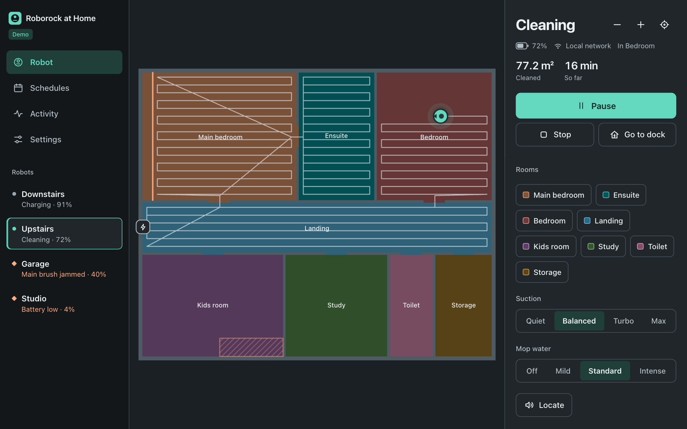
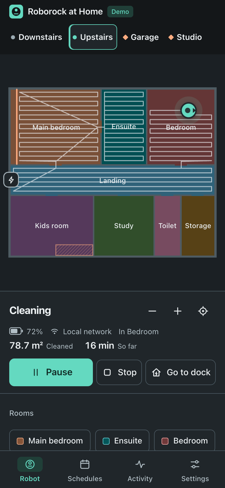
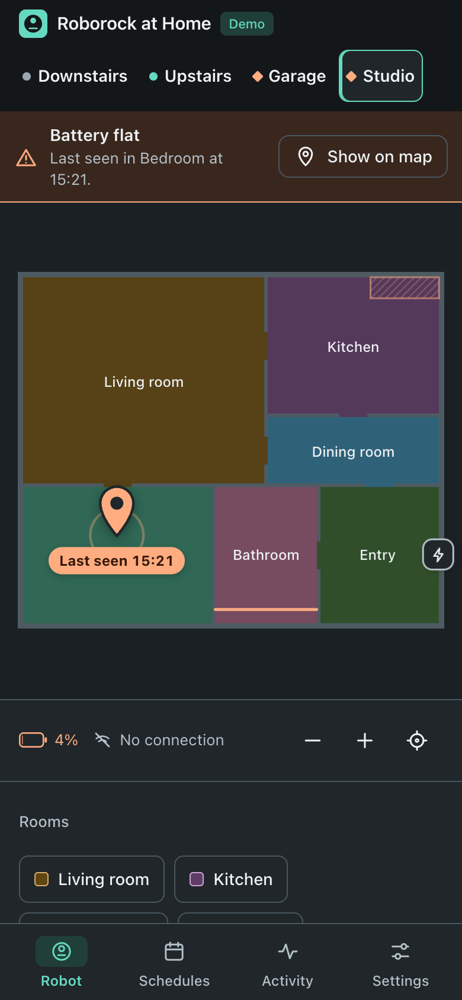

# Roborock at Home

A small, fast control panel for Roborock robot vacuums that you run on your
own machine: a Raspberry Pi, a home server, an old laptop.

- **Instant.** Open a robot and its map is there. No spinner while an app
  talks to a cloud. The server keeps every robot's state and map in memory and
  the page only ever receives what changed.
- **Finds a dead robot.** When a robot gets stuck or its battery dies under a
  bed, it shows where it was last seen, on the map, with the room and the time.
- **Rooms and schedules.** Tap rooms on the map and clean them. "Kitchen,
  weekdays at 9:30" takes a few seconds to set up.
- **Several robots**, side by side.
- **Phone, tablet, desktop.** One page, laid out properly for each.
- **Remote access** through a Cloudflare tunnel, switched on from Settings.
- **An API for agents and scripts.** Everything the page does, documented in
  one file the app serves itself.

<p align="center"></p>
<p align="center">&nbsp;&nbsp;</p>

Not made by or affiliated with Roborock. Your robots stay set up exactly as
they are in the Roborock app; nothing is flashed, rooted or re-paired.

## Install

On the machine that will run it (Linux with systemd; no root needed):

```sh
curl -fsSL https://raw.githubusercontent.com/EspoTek/roborock-at-home/master/install.sh | sh
```

It prints an address to open and a first sign-in. Open it, go to Settings,
enter your Roborock account's email, type in the code Roborock emails you, and
your robots appear.

The same command upgrades. To remove it:

```sh
curl -fsSL https://raw.githubusercontent.com/EspoTek/roborock-at-home/master/install.sh | sh -s -- --uninstall
```

(add `--purge` to delete its data as well).

### Just looking?

Four simulated robots, nothing installed, no account:

```sh
uvx --from https://github.com/EspoTek/roborock-at-home/archive/master.tar.gz roborock-at-home serve --demo
```

## What it needs

- Linux with systemd for the installer (it sets up a per-user service that
  starts at boot). Anything else that runs Python 3.12 can run
  `roborock-at-home serve` by hand.
- A Roborock account with robots that speak Roborock's "V1" protocol: the S
  series, most of the Q series, Qrevo, Saros. Developed against an S7 Max
  Ultra.
- The machine on the same network as the robots. Commands and status then go
  straight over the LAN; maps come through Roborock's cloud (the robot offers
  them no other way).

## Speed and size

Measured on the machine it was built for, an old laptop with a 1.1 GHz
dual-core Celeron N3350, running two real robots:

| | |
|---|---|
| Any request the page makes (state, the page itself, a "not modified") | 2 ms median, 3.3 ms at the 99th percentile, client included |
| The same on a current laptop | 0.15 ms |
| The page | one file, 34 kB compressed, then cached |
| Everything about two robots (`/api/state`) | 1.1 kB compressed |
| A live update (one robot's battery, position or state) | about 120 bytes |
| Sent while nothing is happening | nothing, bar a keep-alive every 25 s |
| Switching between robots in the page | no request at all, 1 to 3 ms |
| Parsing a real 373 x 567 map | 3 ms (the usual parser: 210 ms or more) |
| Memory, app with real robots | about 65 MB |
| Memory, with remote access on (adds `cloudflared`) | about 100 MB in total |
| Memory, demo | 30 to 45 MB |
| Processor when idle, tunnel included | 1.3% of one core |

Most of the app's memory is the Roborock library; the app's own code adds a
couple of megabytes. At about 100 MB all in, it leaves plenty of room on a
512 MB Raspberry Pi, though it has not been run on one yet.

How it stays quick:

- Nothing you tap waits on a robot or a cloud. The server already holds every
  robot's state and map; reads are answered from memory, as bytes prepared when
  the data last changed.
- The page keeps every robot's map ready, so opening a robot is instant, and
  it remembers the last state, so reopening the page paints at once.
- Buttons act immediately and show the result; the command goes to the robot
  behind them and you only hear about it if it fails.

## Signing in

Each person has their own name and password. A fresh install has one,
`admin`, with a generated password; add people under Settings, or:

```sh
roborock-at-home user add you@example.com
roborock-at-home user list
roborock-at-home user remove admin
```

Passwords are stored as scrypt hashes. Five wrong tries from one address lock
that address out for 30 seconds, doubling from there.

## Remote access

Settings, Remote access:

- **Quick link**: one switch. You get a `https://....trycloudflare.com`
  address that works from anywhere. No Cloudflare account. The address changes
  when the app restarts.
- **Your own address**: create a tunnel in the Cloudflare dashboard (Zero
  Trust, Networks, Tunnels), give it a public hostname pointing at
  `http://localhost:8770`, and paste its token. The address is then permanent.

The app downloads `cloudflared` the first time you switch this on, and runs it
itself. Everything stays behind the sign-in.

## For agents and scripts

Make a token under Settings (or `roborock-at-home token --name Agent --scope
control`). A `read` token can look; a `control` token can also send robots to
clean and manage schedules. Neither can change who has access.

```sh
export RAH=http://192.168.1.50:8770 TOKEN=rah_...

# Everything, in one small response
curl -s -H "Authorization: Bearer $TOKEN" $RAH/api/state

# Where is it, and does it need someone?
curl -s -H "Authorization: Bearer $TOKEN" $RAH/api/robots | jq '.[] | {name, activity, battery, attention: .attention.summary}'

# Clean the kitchen
curl -s -X POST -H "Authorization: Bearer $TOKEN" -H 'Content-Type: application/json' \
  -d '{"command":"clean_rooms","rooms":[16]}' $RAH/api/robots/ROBOT_ID/command

# A picture of the map with the robot on it
curl -s -H "Authorization: Bearer $TOKEN" -o map.png $RAH/api/robots/ROBOT_ID/map.png
```

The whole API is in [API.md](src/roborock_at_home/static/API.md), which the
app also serves at `/api/docs`, so an agent can read it from the app.

## How it works

One Python process. It signs in to your Roborock account once (with
[python-roborock](https://github.com/Python-roborock/python-roborock), the
library behind Home Assistant's integration), finds your robots, and from then
on talks to them over the LAN. It reads each robot's status every few seconds
while it is working or someone is looking, and slows down when nothing is
happening. Maps are parsed by a parser written for this app that takes about
3 ms where the usual one takes hundreds.

Whatever a robot last reported is kept, in memory and on disk. So when one
stops answering, its last position, battery and map are still there, and the
page says so in words: "Offline since 21:40. Battery was at 4%, last seen in
Bedroom."

The page is a single HTML file with no framework and no outside requests. It
opens one live connection and gets only the fields that change. Schedules are
run by the app itself, in your time zone.

Your data lives in `~/.local/share/roborock-at-home`. Nothing is sent
anywhere except to Roborock (as their own app does) and, if you switch on
remote access, through Cloudflare.

## Things to know

- Schedules run only while the app is running. One that comes due while the
  machine is off is skipped, not run late.
- A robot that was offline for a long time can take a while to be noticed
  again, because the connection library waits longer between tries the longer
  a robot has been gone.
- Only the map the robot is currently using is shown; the app never makes a
  robot switch between saved floors.
- Camera view, firmware updates, and editing no-go zones are not here. Use the
  Roborock app for those; the two work side by side.

## Development

```sh
git clone https://github.com/EspoTek/roborock-at-home && cd roborock-at-home
uv sync
uv run pytest
RAH_DEMO_PASSWORD=demo uv run roborock-at-home serve --demo   # sign in as demo / demo
```

`src/roborock_at_home/model.py` is the place to start reading: it defines the
few types every part is written against.

## Licence

MIT. Roborock is a trademark of Beijing Roborock Technology Co., Ltd.; this
project is independent of them.
